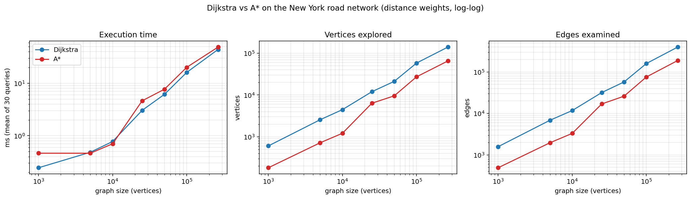
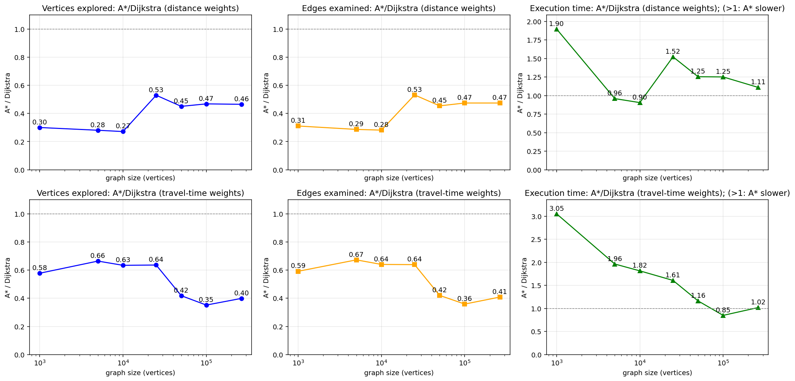
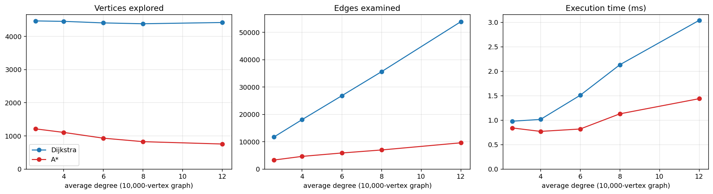

# Shortest-Path Planning in a Large-Scale Road (IoV) Mobility Network
*Dijkstra vs A\* on the 9th DIMACS New York road network. All numbers below were produced by the code in this project (Python preprocessing and analysis, C++ algorithms) and are reproducible with `./run_all.sh`.*

## Headline results
- **Graph:** 264,346 vertices, 365,050 undirected weighted edges (real road distances), average degree 2.76, maximum degree 8, one connected component.
- **Correctness:** Dijkstra and A\* returned the **same optimal cost in all 420 (query, size, weight-model) comparisons** (0 mismatches), and every returned path was re-checked edge by edge against the graph (0 invalid paths).
- **A\* vs Dijkstra (distance weights, mean of 30 queries per size):** A\* explores 27-53% of the vertices Dijkstra explores, and its execution time ranges from 90% to 190% of Dijkstra's (above 100% means A* is slower). On the full 264,346-vertex graph: 44.2 ms (Dijkstra) vs 49.0 ms (A\*).
- **Recommendation:** A\* with a coordinate-based heuristic for point-to-point route planning (see Part F, Q10).

## Part A: Dataset selection
| Item | Answer |
|---|---|
| 1. Dataset name | 9th DIMACS Implementation Challenge (Shortest Paths): USA road network, **New York City** (`USA-road-d.NY` distance graph, `USA-road-t.NY` travel-time graph, `USA-road-d.NY.co` coordinates) |
| 2. Source / URL | http://www.diag.uniroma1.it/challenge9/download.shtml (public domain). Original data: US Census Bureau TIGER/Line files; graphs assembled by Dominik Schultes. Citation: *9th DIMACS Implementation Challenge: Shortest Paths*, Demetrescu, Goldberg, Johnson (eds.), 2006. |
| 3. Description | A real road network of the New York City area (longitude -74.50 to -73.50, latitude 40.30 to 41.30). Two graphs share one topology (distance weights and travel-time weights); a third file gives each node's longitude/latitude. |
| 4. Records, nodes, edges | 264,346 coordinate records; 733,846 arc records per graph file; **264,346 nodes** and **365,050 undirected edges** used (after merging the two opposite arcs of each road and 3,746 repeated arcs). Experiment graphs of 1,000 to 264,346 vertices are carved out of it (Part B). |
| 5. Conversion to a graph | Each coordinate record becomes a vertex; each pair of opposite `a u v w` arcs becomes one undirected weighted edge stored in an adjacency list (details in Part B). |
| 6. Vertex | A road intersection or road endpoint, with a longitude and latitude. |
| 7. Edge | A road segment between two intersections that can be driven in both directions at the same cost. |
| 8. Edge weight | Primary: segment **distance** (positive integers, min 1, median 951, max 36,946). Secondary: **travel time** (min 2, median 2,333, max 92,366). The files do not state the unit; distance weights are about 10x the great-circle length in metres, so they are called *distance units* here. |
| 9. Why suitable | Real, public, citable; large (264K vertices / 365K edges) so 1K to 264K-vertex experiments are possible; positive weights; undirected after merging (0 asymmetric arc pairs); sparse like real road networks; coordinates enable a geometric A\* heuristic; two weight models; standard shortest-path benchmark. |

## Part B: Graph construction
**Preprocessing steps (`Preprocessing.py`):**

1. Read `Coordinates.gz` (longitude/latitude in micro-degrees, divided by 10^6) and both `.gr` files (733,846 arcs each).
2. Drop self-loops (0 found). Merge repeated arcs between the same two intersections (3,746 found), keeping the smaller weight, since only the cheapest parallel segment can lie on a shortest path.
3. Verify symmetry: every arc has a reverse arc with the same weight (**0 asymmetric pairs**), so treating roads as undirected loses nothing. Result: 365,050 undirected edges.
4. Relabel vertices 1..N to 0..N-1; check connectivity: **1 component**, 0 isolated vertices, so no vertices are discarded.
5. Pick a start vertex with a fixed seed (42) and run one BFS. The first *n* vertices of the BFS order, with all edges among them, form a **connected** subgraph of size *n*; the subgraphs are nested.
6. Write each graph to a text file (`n m`, coordinates, then `u v distance time` per edge); the C++ program builds the adjacency list from it. Only the information needed for shortest paths is kept.

| Vertices | Edges (undirected) | Average degree (2E/V) | Maximum degree | C++ adjacency-list check |
|---|---|---|---|---|
| 1,000 | 1,276 | 2.552 | 6 | matches (1,000 V, 1,276 E) |
| 5,000 | 6,565 | 2.626 | 6 | matches (5,000 V, 6,565 E) |
| 10,000 | 12,902 | 2.580 | 6 | matches (10,000 V, 12,902 E) |
| 25,000 | 32,924 | 2.634 | 6 | matches (25,000 V, 32,924 E) |
| 50,000 | 66,783 | 2.671 | 6 | matches (50,000 V, 66,783 E) |
| 100,000 | 134,763 | 2.695 | 6 | matches (100,000 V, 134,763 E) |
| 264,346 | 365,050 | 2.762 | 8 | matches (264,346 V, 365,050 E) |

Average degree is 2E/V (each undirected edge appears in two adjacency lists). Smaller BFS subgraphs have a slightly lower average degree because boundary vertices lose neighbours outside the region.

## Part C: Dijkstra's algorithm (C++)
Implemented from scratch in `Algorithms.cpp`: adjacency list `vector<vector<Edge>>`, `std::priority_queue` used as a **min-priority queue** (lazy deletion of stale entries), predecessor array, and explicit path reconstruction. No graph-library shortest-path routine is used. Per-query arrays are reset in O(1) with a version counter, so a query's cost depends on the explored region only.

**Time complexity:** each vertex is finalised once and each adjacency entry is scanned once, so there are O(E) edge scans. Every successful relaxation pushes one heap entry, so the heap holds at most O(E) entries and each push/pop costs O(log E) = O(log V). Total **O((V + E) log V)**. For a connected road graph E = O(V) (average degree about 2.8), so this is **O(V log V)**. Space: O(V + E).

**Example query** (1,000-vertex graph, source = DIMACS node 58364, destination = DIMACS node 116548):

| Metric | Dijkstra | A* |
|---|---|---|
| Shortest-path cost | 47,957 | 47,957 |
| Hops (edges on the path) | 26 | 26 |
| Vertices explored | 944 | 284 |
| Edges examined | 2,438 | 776 |
| Execution time (ms, mean per run) | 0.0617 | 0.0940 |

**Complete shortest path (original DIMACS vertex ids), Dijkstra:**

`58364 -> 58359 -> 58356 -> 58349 -> 58344 -> 58345 -> 116824 -> 116823 -> 116804 -> 116805 -> 116819 -> 116822 -> 116821 -> 116534 -> 116533 -> 116530 -> 116528 -> 116511 -> 116510 -> 116507 -> 116508 -> 116524 -> 116545 -> 118391 -> 116544 -> 116549 -> 116548`

**Same path found by A\*:** yes, identical. Complete paths for every query are in `results/size_<n>_<d|t>_paths.txt`.

## Part D: A* algorithm (C++)
Same graph and data structures; the heap is ordered by f(v) = g(v) + h(v) with

`h(v) = c * haversine(v, D)`, where `c = min over all edges (u,v) of w(u,v) / haversine(u,v)`.

- **Why scaled:** weights are not in metres (about 10 weight units per metre), so the raw great-circle distance is a poor (too weak) estimate. `c` is the largest constant for which `c * haversine(u,v) <= w(u,v)` holds on every edge. It is computed once per graph and shrunk by 1e-9 to be safe against floating-point rounding.
- **Admissible:** any path from v to D is a chain of edges; by the triangle inequality for great-circle distance, its length is at least `haversine(v,D)`, and each edge weight is at least `c` times its great-circle length, so the true cost is at least `h(v)`. So h never overestimates.
- **Consistent:** `h(u) = c*hav(u,D) <= c*hav(u,v) + c*hav(v,D) <= w(u,v) + h(v)`. Hence each vertex is finalised the first time it leaves the heap, and the first time D leaves the heap its cost is optimal.
- **Values of c:** 1,000: 9.64, 5,000: 9.64, 10,000: 9.47, 25,000: 7.16, 50,000: 7.16, 100,000: 7.15, 264,346: 7.15 (distance weights). It drops from 9.6 to 7.2 at 25,000 vertices because a few edges in the larger regions have a low weight/length ratio; this makes the heuristic weaker on larger graphs (median ratio is about 10).

The example query's A\* result is shown in the Part C table. Metrics are defined identically for both algorithms: *vertices explored* = vertices removed from the heap and finalised (destination included); *edges examined* = adjacency entries scanned from finalised vertices.

## Part E: Experimental evaluation
Each graph size uses **30 random source-destination pairs** (fixed seed); each query is repeated at least 5 times and for at least 50 ms per algorithm, the mean time per run is kept, then everything is **averaged over the 30 queries**. Graph sizes: 1,000, 5,000, 10,000, 25,000, 50,000, 100,000, 264,346 (the last one is the entire dataset).

### Primary: distance weights

| Graph size | Algorithm | Avg shortest-path cost | Avg vertices explored | Avg edges examined | Avg execution time (ms) |
|---|---|---|---|---|---|
| 1,000 | Dijkstra | 40,557 | 602 | 1,575 | 0.245 |
|  | A* | 40,557 | 181 | 489 | 0.464 |
| 5,000 | Dijkstra | 77,624 | 2,555 | 6,838 | 0.484 |
|  | A* | 77,624 | 717 | 1,959 | 0.463 |
| 10,000 | Dijkstra | 100,238 | 4,466 | 11,732 | 0.776 |
|  | A* | 100,238 | 1,212 | 3,303 | 0.702 |
| 25,000 | Dijkstra | 166,194 | 12,025 | 31,853 | 3.046 |
|  | A* | 166,194 | 6,365 | 16,931 | 4.634 |
| 50,000 | Dijkstra | 213,462 | 21,230 | 57,379 | 6.152 |
|  | A* | 213,462 | 9,562 | 26,044 | 7.710 |
| 100,000 | Dijkstra | 344,072 | 58,349 | 159,557 | 16.150 |
|  | A* | 344,072 | 27,306 | 75,646 | 20.199 |
| 264,346 | Dijkstra | 557,399 | 140,744 | 397,649 | 44.203 |
|  | A* | 557,399 | 65,442 | 188,507 | 49.023 |

### Secondary: travel-time weights

| Graph size | Algorithm | Avg shortest-path cost | Avg vertices explored | Avg edges examined | Avg execution time (ms) |
|---|---|---|---|---|---|
| 1,000 | Dijkstra | 92,050 | 596 | 1,558 | 0.058 |
|  | A* | 92,050 | 344 | 922 | 0.177 |
| 5,000 | Dijkstra | 177,139 | 2,532 | 6,770 | 0.414 |
|  | A* | 177,139 | 1,682 | 4,554 | 0.813 |
| 10,000 | Dijkstra | 217,850 | 4,477 | 11,767 | 0.858 |
|  | A* | 217,850 | 2,838 | 7,534 | 1.558 |
| 25,000 | Dijkstra | 310,906 | 11,345 | 30,094 | 2.881 |
|  | A* | 310,906 | 7,215 | 19,226 | 4.633 |
| 50,000 | Dijkstra | 335,127 | 20,058 | 54,455 | 5.763 |
|  | A* | 335,127 | 8,391 | 22,886 | 6.706 |
| 100,000 | Dijkstra | 474,785 | 57,576 | 158,145 | 21.190 |
|  | A* | 474,785 | 20,242 | 56,713 | 18.008 |
| 264,346 | Dijkstra | 749,853 | 144,596 | 409,324 | 48.543 |
|  | A* | 749,853 | 57,687 | 167,194 | 49.508 |

**Verification.** 420 comparisons (7 sizes x 2 weight models x 30 queries): cost mismatches = 0; invalid paths = 0. The two algorithms returned the identical vertex sequence in 411 of 420 queries; in the others they returned different paths of equal cost (ties).

**Disconnected and special pairs** (test graph = 1,000-vertex subgraph + a 2-vertex component + 1 isolated vertex):

| Case | Algorithm | Pair | Result | Hops | Vertices explored | Edges examined |
|---|---|---|---|---|---|---|
| main part -> other component | Dijkstra | 0 -> 1000 | unreachable (inf, empty path) | - | 1000 | 2552 |
| main part -> other component | A* | 0 -> 1000 | unreachable (inf, empty path) | - | 1000 | 2552 |
| main part -> isolated vertex | Dijkstra | 0 -> 1002 | unreachable (inf, empty path) | - | 1000 | 2552 |
| main part -> isolated vertex | A* | 0 -> 1002 | unreachable (inf, empty path) | - | 1000 | 2552 |
| inside the small component | Dijkstra | 1000 -> 1001 | 100 | 1 | 2 | 1 |
| inside the small component | A* | 1000 -> 1001 | 100 | 1 | 2 | 1 |
| source = destination | Dijkstra | 7 -> 7 | 0 | 0 | 1 | 0 |
| source = destination | A* | 7 -> 7 | 0 | 0 | 1 | 0 |
| ordinary reachable pair | Dijkstra | 3 -> 500 | 31,874 | 24 | 583 | 1537 |
| ordinary reachable pair | A* | 3 -> 500 | 31,874 | 24 | 147 | 422 |

Unreachable pairs make both algorithms exhaust the source's component and return `inf` with an empty path, with no crash.

**Density experiment** (extra synthetic local edges added to the 10,000-vertex graph; see Part F, Q6):

| Avg degree | Edges | Algorithm | Avg vertices explored | Avg edges examined | Avg time (ms) |
|---|---|---|---|---|---|
| 2.58 | 12,902 | Dijkstra | 4,466 | 11,732 | 0.979 |
|  |  | A* | 1,212 | 3,303 | 0.841 |
| 4.00 | 20,000 | Dijkstra | 4,453 | 18,089 | 1.015 |
|  |  | A* | 1,105 | 4,639 | 0.770 |
| 6.00 | 30,000 | Dijkstra | 4,406 | 26,813 | 1.509 |
|  |  | A* | 931 | 5,880 | 0.819 |
| 8.00 | 40,000 | Dijkstra | 4,380 | 35,597 | 2.133 |
|  |  | A* | 826 | 6,983 | 1.129 |
| 12.00 | 60,000 | Dijkstra | 4,418 | 53,895 | 3.041 |
|  |  | A* | 755 | 9,601 | 1.439 |

## Part F: Analysis
**Q1. Why is the dataset suitable?** It is a real, public, citable road network with 264,346 vertices and 365,050 edges, large enough that Dijkstra explores about 140,744 vertices per query on average. It has positive weights, a sparse structure typical of vehicular networks (average degree 2.76), coordinates for a geometric heuristic, and two weight models. It is one connected component, so every random pair is solvable and results are not distorted by unreachable pairs.

**Q2. How was the raw dataset turned into a weighted graph?** Coordinates became vertices; the two opposite arcs of each road were verified symmetric (0 exceptions) and merged into one undirected edge weighted by distance (or travel time); repeated arcs kept the minimum; ids were relabelled to 0..n-1; subgraphs were grown by BFS to stay connected; the C++ code builds the adjacency list (Part B).

**Q3. Same optimal cost?** Yes: 0 mismatches in 420 comparisons, and each path's weights re-sum to the reported cost. A\* with an admissible and consistent heuristic is guaranteed optimal, so this is expected. Where several shortest paths of equal cost exist, the algorithms may return different vertex sequences (identical in 411 of 420 queries) but never different costs.

**Q4. Which explores fewer vertices, and why?** A\*: 27-53% of Dijkstra's vertices (distance weights; 35-66% for travel time). Dijkstra expands every vertex whose distance from the source is below the answer, i.e. a disc around S. A\* adds h(v) to the priority, so vertices pointing away from D are postponed and the search stretches toward D. The saving is smaller than the ideal because the heuristic is a straight-line bound scaled by the *minimum* weight/length ratio (9.64 on small graphs, 7.15 on the larger ones), while typical edges have a ratio near 10, so h underestimates the remaining cost. The saving shrinks from about 73% fewer vertices at 10,000 vertices to 47% at 25,000, which coincides with the drop of `c` (a plausible cause, though graph size changes at the same time). With travel-time weights A\* explores 58-66% of Dijkstra's vertices up to 25,000 vertices but 35-42% from 50,000 vertices upward, so its benefit relative to distance weights is not uniform; it depends on the region and on the heuristic scale.

**Q5. How does execution time vary with graph size?** Dijkstra grows from 0.245 ms (1,000 vertices) to 44.2 ms (264,346 vertices); A\* from 0.464 ms to 49.0 ms. A log-log fit gives slopes of 0.99 (Dijkstra) and 0.95 (A\*): time grows somewhat faster than the number of vertices. With random endpoints the typical source-destination distance grows with the graph, so the explored region grows about in proportion to V (602 to 140,744 vertices for Dijkstra); the extra growth comes from the log factor of the heap and, most likely, from cache misses as the arrays outgrow the CPU caches (not measured separately here). A\* explores fewer vertices at every size, but its execution time is 111% of Dijkstra's at full size (ratios range from 90% to 190% across sizes), plausibly because each A\* vertex also costs a haversine evaluation (sin, asin, sqrt) that cancels out the saving in vertices on this machine.

**Q6. Effect of graph density.** Real road networks are sparse (average degree 2.6-2.8), so E = O(V) and the (V+E) log V bound is dominated by V log V. To isolate density, I added synthetic *local* shortcut edges (endpoints a few hops apart, weight about 10x great-circle length, like real edges) to the 10,000-vertex graph, raising the average degree from 2.58 to 12. Edges examined by Dijkstra rose from 11,732 to 53,895 (4.6x) and its time from 0.98 to 3.04 ms (3.1x), while vertices explored stayed nearly constant (4,466 to 4,418). So density affects the cost mainly through the number of edge relaxations (and heap pushes), roughly proportionally to degree; A\* shows the same pattern (3,303 to 9,601 edges) but from a much lower base. Caveat: the added edges are synthetic and slightly shorten routes (average cost falls from 100,238 to 86,257).

**Q7. Theoretical time complexity of the Dijkstra implementation.** O((V + E) log V) with a binary heap and lazy deletion (at most E heap entries; each operation O(log E) = O(log V)); O(V log V) on sparse road graphs where E = O(V). Space O(V + E).

**Q8. Heuristic for A\*; admissible/consistent?** `h(v) = c * haversine(v, D)` with `c` = the minimum weight/great-circle-length ratio over all edges. Admissible and consistent, by the triangle-inequality argument in Part D (the scaling by the minimum ratio is what guarantees the bound holds for every edge, even when weights are not expressed in metres). Consistency means no vertex is re-opened, which the implementation relies on (closed vertices are never re-expanded), and the 0 cost mismatches are consistent with it.

**Q9. Difficulties converting the dataset.** (1) The `.gr` files are *directed arcs*; I had to verify symmetry (0 exceptions) and merge pairs into undirected edges. (2) 3,746 repeated arcs between the same intersections needed a merge rule (keep the minimum). (3) The weight unit is undocumented; I measured weight/great-circle ratios (about 10) to design a valid heuristic. A raw haversine in metres would still be admissible but far too weak, and a naive 'weight = metres' assumption would have been wrong. (4) Coordinates are integer micro-degrees. (5) Subgraphs must be connected and comparable: BFS prefixes give nested connected graphs, but boundary effects lower their average degree. (6) A single outlier edge can reduce the global scale `c` (it fell from 9.6 to 7.2), weakening A\* on larger graphs. (7) Per-query array initialisation would otherwise dominate small queries, so version stamps are used. (8) Building very dense variants with purely local edges saturates (a degree-20 variant could not be generated), so the density experiment stops at degree 12. (9) Sub-millisecond timings are noisy, so each query is repeated until at least 50 ms have elapsed (and at least 5 runs) and the mean per run is used.

**Q10. Recommendation for large-scale IoV/UAV route planning.** **A\*** for point-to-point queries: identical optimal routes, about 47-73% fewer vertices and 47-72% fewer edges, while execution time is mixed on this machine (A*/Dijkstra time ratio from 0.90 to 1.90), with no preprocessing other than one pass to compute `c`. Dijkstra remains preferable when no coordinates exist, when one source needs routes to many destinations, or when edge costs can drop below the heuristic's assumption. A\* pays off most when the heuristic is cheap to evaluate, for example a precomputed or simpler lower bound. For a production system with millions of queries, the next step would be a stronger heuristic (landmarks/ALT) or hierarchical methods such as contraction hierarchies, since plain A\* still visits tens of thousands of vertices on a city-scale graph.

## Reproducibility
`./run_all.sh` runs: `Preprocessing.py` (graph files) -> `g++ -O2 Algorithms.cpp` -> `experiments.py` (all runs) -> `Analysis.py` (this report). Seeds are fixed (42); timings vary slightly between machines, all other numbers are deterministic.